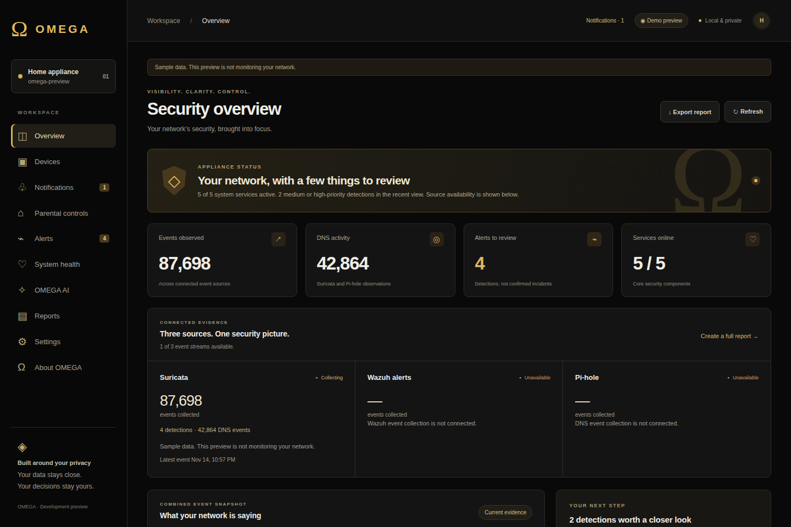

# Ω OMEGA

**Your network. Your control.**

OMEGA is an experimental local network-security appliance project designed for
the **Raspberry Pi 5 with 8 GB RAM**, targeting **Raspberry Pi OS Lite 64-bit on
Debian 13**. It brings network detections, endpoint events, DNS observations,
device context, retained evidence, reports and local AI explanations into one
operator dashboard.

**Founder & Security Architect: Lawrence Wagle Jr**

**0.1.0-preview.1 · Experimental source preview** · [Apache 2.0](LICENSE)

The intended appliance stack combines **Suricata** network detections and EVE
JSON records, **Pi-hole** DNS observations and separately configured DNS blocking,
and **EveBox** for reviewing Suricata events. A **Wazuh agent on the Pi** connects
to a **separately provisioned Wazuh manager** for endpoint monitoring. OMEGA reads
configured manager alerts and JSON archives through a restricted SSH/rsync
connection; a Wazuh agent alone does not supply those manager logs.

**Tailscale** provides separately provisioned remote access, while **Fail2ban**
can provide externally configured host protection against repeated authentication
failures. Fail2ban is not packaged, pinned or configured by this source preview.
**Ollama** and the **Qwen3** model provide the intended on-appliance AI runtime for
explaining selected evidence; the assistant does not execute commands or block
traffic, and inference is disabled in the fictional demo.

OMEGA's **Python and SQLite** services provide the browser dashboard, persistent
collection, device labels, new-device notifications, cross-source correlation,
evidence exports and paired setup wizard. A **Bash-based nine-command operator
toolkit** supports status, triage, reporting, diagnostics and retention review.
The intended image uses **Docker/containerd** for Pi-hole and EveBox,
**systemd** for service management, and an experimental **rpi-image-gen** builder
with pinned package, container and model inputs. External sensors, managers,
host-protection services, runtimes, models and operating-system packages remain
separate dependencies that require their own provisioning and configuration.

This release provides source code and fictional demos. A finished,
hardware-validated appliance image is not available. The
[source-preview guide](docs/source-preview.md) and
[validation report](docs/source-preview-validation.md) describe the tested scope
and remaining gaps.

## See the preview

[](https://lawrencewaglejr.github.io/omega-source-preview/)

[▶ Watch the 47-second fictional demo](https://lawrencewaglejr.github.io/omega-source-preview/) ·
[Browse screenshots and run it locally](docs/demo.md)

The demo does not monitor a live network or run AI inference.

## Software stack

Versions below describe the repository's pinned appliance inputs or recorded
validation environment; they are not claims about the latest upstream releases.

| Software | Role in OMEGA | Version or source boundary |
| --- | --- | --- |
| **Suricata** | Network detections, DNS and other EVE JSON activity | Appliance package pin: 7.0.10 |
| **Wazuh** | Endpoint events, alerts and archives; local or restricted remote-manager collection | Agent package pin: 4.14.7; manager provisioned separately |
| **Pi-hole** | DNS observations, device observations and separately configured DNS blocking | Appliance container pin: 2026.07.2 |
| **EveBox** | Additional Suricata event-viewing interface | Appliance container pin: 0.28.0 |
| **Tailscale** | Separately provisioned remote access | Appliance package pin: 1.102.3 |
| **Fail2ban** | Host protection against repeated authentication failures | Externally installed and configured; not packaged, pinned or configured by this source preview |
| **Ollama** | Local inference service for evidence-based explanations | Appliance runtime pin: 0.33.3, ARM64 CPU |
| **Qwen3** | Local language model served through Ollama | Pinned model: `qwen3:1.7b` |
| **Docker / containerd** | Container runtime for the pinned Pi-hole and EveBox images | Appliance Docker package pin: 26.1.5; exact dependency versions in build locks |
| **Python and SQLite** | HTTP services, persistent telemetry, device state, correlation and reports | Current source suites executed with Python 3.13.5; SQLite through the standard library |
| **HTML, CSS and JavaScript** | Browser dashboard and guided setup interface | Project browser assets; no bundled npm dependencies |
| **Node.js** | Browser-logic test runner | Current validation: 20.19.2; original checkpoint: 22.22.1; not required for the Python demo |
| **Bash, GNU utilities and jq** | Nine-command operator toolkit and managed command installation | External command-layer prerequisites |
| **OpenSSH, rsync and ACL tools** | Restricted Wazuh-manager transport and source permissions | External integration prerequisites |
| **systemd** | Service accounts, lifecycle and appliance service isolation | Appliance integration; services require explicit provisioning and activation |
| **Raspberry Pi OS / Debian** | ARM64 appliance base | Image target: Raspberry Pi OS Lite 64-bit, Debian 13 Trixie |
| **rpi-image-gen and build tools** | Experimental image construction and verification | Pinned rpi-image-gen v2.8.0, bdebstrap, genimage and other locked inputs |
| **Bubblewrap and namespace tools** | Disposable, isolated source validation | Test/build prerequisites; not required for browsing the fictional demo |

See the [image build contract](image/README.md),
[offline AI inventory](docs/offline-ai-inputs.md),
[exact package manifest](image/locks/packages.manifest), and
[third-party notices](docs/third-party-notices.md) for dependency details.
The OMEGA Apache license does not relicense these external projects.

## Features

### Security dashboard and alert review

- Combined overview of observed events, DNS activity, detections, connected
  evidence sources and monitored service status.
- Alert search and filtering by source and priority, with signatures, addresses
  and reported hostnames available for investigation.
- Source availability, freshness, collection boundaries and missing evidence
  shown alongside the results.
- System-health views for service state, storage and integration diagnostics.

### Persistent evidence and cross-source context

- SQLite-backed collection from configured Suricata EVE data, Wazuh alerts and
  archives, and the Pi-hole database.
- Original collected sensor records retained alongside normalized event data.
- Persistent collection cursors, restart continuity, source-rotation handling,
  and operator-selected retention and event-count limits.
- Gzip archive processing that retains source evidence and releases completed
  expansion caches only after committed completion; partial work remains retryable.
- Lossless hexadecimal preservation of undecodable selected Pi-hole text in
  original records, with binary values excluded from normalized text indicators.
- Correlation candidates based on shared device addresses and time windows, with
  coverage limits and relayed Suricata observations identified.
- Background correlation yields to explicit report work and shutdown, and
  releases database readers when it exits.

An alert or correlation is a lead to investigate. Shared timing or an address
does not establish causation, device identity, or confirmed compromise. An event
relayed through Wazuh is not independent corroboration of the original event.

### Device inventory and notifications

- Pi-hole network or DHCP-lease observations, with an optional configured
  authorized-scan observation input.
- Persistent device records, reported hostnames, friendly labels and editable
  device types.
- Newly observed-device notification inbox after the initial baseline, with
  review/acknowledgment controls.
- Optional browser notifications while the dashboard is open and permission is
  granted. Email and phone-push delivery are not connected.
- Completed inventory snapshots remain available while a writer is busy.

Device observations do not enumerate every Wi-Fi association or prove current
online status. Coverage depends on the configured source; changing or private
MAC addresses can appear as new devices.

### Local AI assistant

- On-appliance Ollama integration with the pinned Qwen3 model for the intended
  image configuration.
- Model-availability diagnostics distinguish an unconfigured model, a missing
  model, an unavailable service and demo-disabled inference.
- Questions and explanations use declared evidence aggregates and selected
  events or correlations, with references and coverage limitations.
- Local inference endpoints bind to loopback. The fictional demos do not call AI.

The assistant can explain evidence and suggest a next check. It cannot execute
commands, change settings, block traffic or repair an incident. Answers can be
slow or wrong; important conclusions require operator review. A model being
installed does not establish inference quality.

### Reports and evidence exports

- Quick text snapshots with service state, source coverage and recent detections.
- Private asynchronous full-report jobs using a consistent retained-evidence
  snapshot on a configured live collector with local AI.
- Downloadable ZIP bundles containing a readable HTML assessment, coverage and
  correlation JSON, device context, normalized `events.jsonl`, and original
  `source-events.jsonl` records.
- Job ownership and expiry checks, progress reporting and private report storage.
- Deterministic evidence remains available in a completed report if its AI
  analysis cannot finish.

AI reviews aggregates and selected examples, not every raw record individually.
Exports cover retained collected evidence, not unavailable upstream history.
Operational reports can contain private network information and belong outside
this repository.

### Guided setup and manager connection

- A paired browser setup wizard with a one-time pairing code, expiring session,
  loopback listener and protected write operations.
- Source/prerequisite checks, first dashboard password setup and retention choices.
- Separate configuration, explicit service activation and fresh-evidence/local-AI
  verification steps.
- Device-owned SSH identity and verified manager host key for restricted Wazuh
  log pulls after a manager administrator grants access.
- An offline operator helper for first-use configuration on a provisioned device.

The wizard is included in source and packaging tests. Fresh-device acceptance,
production HTTPS access, device identity and network/sensor provisioning remain
separate work. It is not a recovery or password-reset interface for an existing
appliance. See the [first-boot guide](docs/dashboard-first-boot.md) and
[Wazuh-manager guide](docs/wazuh-manager-setup.md).

### Protection preferences

The dashboard can save optional adult-site-filtering and message-review
preferences. Saving them does not activate filtering or connect messaging
accounts. Parental enforcement, family profiles, schedules and supported
messaging connections remain in development. Pi-hole's separately configured
DNS blocking does not establish that OMEGA's family preferences are enforced.

## Practical security and DFIR examples

**DFIR means Digital Forensics and Incident Response.** In a properly configured
deployment, OMEGA can help an operator investigate suspicious activity, use
separately configured protections and retain evidence. These are illustrative
use cases, not claims that the experimental demo stopped real attacks.

| Example | How the configured stack could help | Investigation value |
| --- | --- | --- |
| **Repeated SSH password guessing** | An externally configured Fail2ban jail can temporarily ban an address after repeated failed logins. Wazuh can report collected authentication events through its separate manager. [Fail2ban documentation](https://github.com/fail2ban/fail2ban). | Review recorded attempts, targeted accounts, timestamps and any subsequent successful login, where those events were collected and retained. |
| **A device requests a blocked malicious domain** | Pi-hole can refuse DNS resolution when a domain matches configured blocking rules and the device uses that resolver. OMEGA can show collected DNS observations and device context. [Pi-hole examples](https://docs.pi-hole.net/group_management/example/). | Identify which observed device requested the domain and when. A blocked lookup alone does not establish infection. |
| **Scanning or suspicious network traffic** | Suricata can alert when traffic visible to its sensor matches configured detection rules. EveBox offers another event-review interface. An operator can investigate and use separately managed containment controls. [Suricata event output](https://docs.suricata.io/en/latest/output/eve/eve-json-output.html). | Examine available addresses, ports, signatures, protocol details and timing. OMEGA does not automatically block these connections. |
| **Unexpected changes to important files** | Configured Wazuh file-integrity monitoring can alert on changes to monitored files. The Pi agent covers its configured sources; other endpoints need their own agents or collection. [Wazuh file-integrity monitoring](https://documentation.wazuh.com/current/user-manual/capabilities/file-integrity/how-it-works.html). | Investigate the reported file change and available hashes, attributes and timestamps. The manager must supply the relevant events to OMEGA. |
| **Exposed administration services** | Properly configured Tailscale access controls can restrict administration to authorized users and devices, reducing the need to expose services publicly. [Tailscale access controls](https://tailscale.com/docs/features/access-control). | Reduce an access path while investigating through an authorized private connection. This does not establish that OMEGA collects Tailscale audit logs. |
| **Malicious text or unsafe paths aimed at OMEGA** | Synthetic adversarial tests exercise command injection, forged result markers, unsafe paths and hostile text handling to catch failures in how the software treats untrusted input. [OMEGA test source](https://github.com/lawrencewaglejr/omega-source-preview/tree/main/tests). | More reliable handling helps distinguish collected content from trusted application output. These are software checks, not evidence that a live attack was stopped. |

For example, a fictional investigation might compare a **10:01 DNS request**,
a **10:02 Suricata alert**, and a **10:03 Wazuh monitored-file change** involving
the same observed device. Investigators must verify timestamps, device mappings
and source records; timing alone does not establish compromise. A relayed copy
of an event is not independent corroboration.

Completed full reports on a configured live collector provide a consistent
retained-evidence snapshot: a readable assessment, coverage/correlation JSON,
normalized events and original collected sensor records. Coverage and retention
limits matter. Formal forensic work still needs appropriate acquisition tools,
preserved originals and a documented chain of custody. AI explanations require
verification against the evidence.

See the [defense and DFIR guide](docs/security-and-dfir.md) for the investigation
example, export contents, component prerequisites and forensic limitations.

## Command-line toolkit

The managed installer provides nine operator commands:

| Command | Purpose |
| --- | --- |
| `omega` | Interactive operator menu |
| `omega-status` | Appliance, service and resource status |
| `omega-health` | Operational checks across the configured stack |
| `omega-report` | Readable Suricata report and timestamped output |
| `omega-alerts` | Alert triage, signatures and priority review |
| `omega-summary` | Plain-English summary of available observations |
| `omega-doctor` | Command-layer, configuration and integration diagnostics |
| `omega-bundle` | Timestamped support bundle with diagnostic output and checksum |
| `omega-cleanup` | Report/support-bundle retention review; dry run by default |

Six evidence/status commands publish a final machine-readable
`OMEGA_RESULT=SUCCESS`, `WARNING`, `UNKNOWN` or `FAILURE` line. Missing or invalid
evidence must not be presented as a healthy network. See the
[command reference](docs/commands.md) for exact contracts and exit codes.

The installer manages command files and receipts, checks destination identity,
and rolls back catchable installation failures. It preserves configuration,
logs, reports and appliance data. It does not install the full security stack,
configure networks, start services or flash a card.

Preview the command installation from a trusted checkout:

```bash
./install.sh install --dry-run
```

Follow the [installation guide](docs/install.md) and
[runtime configuration contract](docs/configuration.md) before installation.

## Try the fictional demos

Use a Linux development workstation. Python 3.13.5 is the verified source runtime
for the current candidate; the original checkpoint used Python 3.14.4.
The dashboard and setup demos use the Python standard library and local modules;
there are no third-party pip packages to install for either demo.

From this repository's root directory:

```bash
python3 -B dashboard/server.py --demo
```

Open **http://127.0.0.1:8088**. The dashboard uses fictional data, does not collect
from your network and does not call a model. Stop it with Ctrl+C.

To preview the guided setup in a separate terminal:

```bash
python3 -B onboarding/server.py --demo --port 8092
```

Open **http://127.0.0.1:8092** and enter pairing code **OMEGA-PREVIEW**.
This simulates setup without generating keys, saving passwords, connecting
sensors, starting services or calling AI. These demos are local development
interfaces; keep them on loopback.

## Appliance and image status

The image source targets a **Raspberry Pi 5 with 8 GB RAM**, with native ARM64
Debian 13 construction and separately verified cached inputs. It describes a
32 GiB master image, disabled managed services, per-device provisioning,
checksums, an SPDX software bill of materials and provenance output.

The source includes pinned package/container/model inventories, upstream input
verification, protected-source checks and isolated offline construction helpers.
These are build contracts, not evidence that a distributable image has passed
native construction, reproducibility, fresh-card boot, recovery or signing.

Current application bytes intentionally differ from shipping image inventories.
This README also differs from the builder's previously authorized README blob;
image source-trust approval requires a separately reviewed update. Existing
verification pins and rejection rules are retained. Do not bypass either gate
to obtain an image-validation pass. See [image documentation](image/README.md)
and [release acceptance requirements](docs/release-preparation.md).

## Validation and known gaps

The current candidate has **272 distinct Python tests** executed across the
application, payload and mapped-identity runs, and **42 browser-logic checks**,
using Python **3.13.5**. The original preview separately recorded four additional
manifest checks and isolated demo smoke checks. Runtime compatibility is based
on execution, not grammar alone.

The four original validation gaps now have these results:

1. Python 3.13 runtime compatibility: **PASS** in the disposable Debian guest.
2. Distinct publisher/collector permissions: **PASS** using real separate mapped
   identities, with no capabilities in the reading/writing children.
3. Strict installer lifecycle harness: **PASS**, 365 assertions and isolation audit.
4. Strict security-results harness: **PASS**, 3,669 assertions and the final
   isolation gate, using the unchanged harness and Debian's trusted tools.

Use the [dated validation report](docs/source-preview-validation.md) for methods,
limitations and results, and the [source-preview guide](docs/source-preview.md)
for exact test commands. Tests use synthetic fixtures and disposable isolation;
operational evidence is not a test fixture. A running service, successful demo
or software test pass does not establish appliance acceptance or network safety.

### Adversarial and failure-mode coverage

The public tests exercise command injection, forged result markers, hostile text,
authentication/origin/CSRF checks, session expiry, symlinks and path traversal,
distinct-identity permissions, interrupted installation, rollback, concurrency
and evidence preservation. Image-input/payload tests also exercise tampering
rejection, with shipping-image acceptance tracked separately.

The recorded test/check/assertion totals above use different units; they are not
counts of distinct attacks. These are synthetic adversarial and regression
checks, not an independent penetration test or a guarantee of network safety.
See the [test source](tests/) and [DFIR/testing guide](docs/security-and-dfir.md).

## Privacy and operating boundaries

- This distribution starts with fresh sanitized Git history. Private deployment
  history, credentials, real household identifiers, telemetry databases, logs,
  report downloads and backups are excluded.
- Configure identities, source permissions, credentials and device labels locally.
  Test credentials and example devices are fictional.
- Dashboard/AI listeners use loopback; remote access requires a separately
  configured owner connection. They are not public Internet services.
- Local AI does not require a cloud inference provider. Wazuh-manager transport,
  Tailscale and configured sensor integrations have their own network boundaries.
- An active service or zero alerts does not prove effective protection or complete
  coverage. Preserve the evidence and verify consequential findings.

## Documentation and source layout

| Path or guide | Contents |
| --- | --- |
| [dashboard/](dashboard/README.md) | Browser UI, telemetry store, devices, correlation, reports, AI and service units |
| [onboarding/](onboarding/) | Paired setup server, browser wizard and appliance configuration logic |
| [scripts/](scripts/) and [install/](install/) | Operator commands and command installation manifest |
| [image/](image/README.md) | Experimental image builder, payload staging and pinned inputs |
| [config/](config/) and [examples/](examples/) | Configuration examples and fictional sample output |
| [tests/](tests/) | Source, browser, installer, permission and image-payload checks |
| [Source-preview guide](docs/source-preview.md) | Version scope, demo, dependencies and test commands |
| [Defense and DFIR](docs/security-and-dfir.md) | Practical examples, evidence exports, adversarial tests and investigation limits |
| [Validation report](docs/source-preview-validation.md) | Recorded passes, blocked checks and deferred acceptance |
| [First setup](docs/dashboard-first-boot.md) | Device configuration, activation and evidence verification |
| [Wazuh-manager setup](docs/wazuh-manager-setup.md) | Restricted reader permissions and SSH connection |
| [Public-source review](docs/public-release-review.md) | Sanitization policy and source-history boundary |
| [Third-party notices](docs/third-party-notices.md) | External software and redistribution boundaries |

## Setup, training and early feedback

Interested in a demo walkthrough, lab setup guidance or operator training?
[Open a setup or training inquiry](docs/setup-and-training.md) through public
GitHub Issues. Scope, availability and any fee are agreed before work is
accepted. Share fictional examples only; do not post operational evidence
or credentials.

We are also seeking early-user feedback before investing in hardware sales.
[Try the demo and share what would help your workflow](docs/early-user-feedback.md).
No hardware orders or preorders are being accepted.

GitHub Sponsors enrollment is being prepared. Sponsorship is not yet available;
no payment or sponsorship benefits are promised by this repository.

## License and attribution

OMEGA's project source code and documentation are licensed under the
**Apache License, Version 2.0**, unless otherwise noted.

**Copyright 2026 Lawrence Wagle Jr.** See [LICENSE](LICENSE) for the complete
terms and [NOTICE](NOTICE) for project attribution.

Suricata, Wazuh, Pi-hole, Fail2ban, EveBox, Tailscale, Ollama, Qwen, Debian,
Raspberry Pi software and other dependencies remain the work of their respective
projects under their own licenses and notices. Their names identify integrations
and do not imply endorsement of OMEGA. See the
[third-party source review](docs/third-party-notices.md).

The software is provided under the license's warranty and liability terms.
