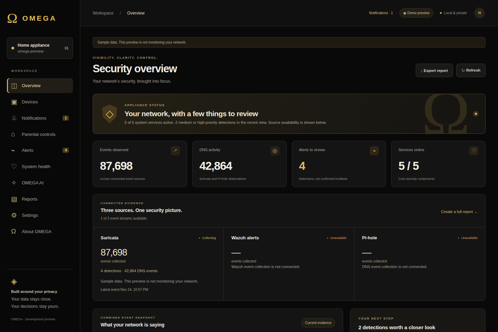
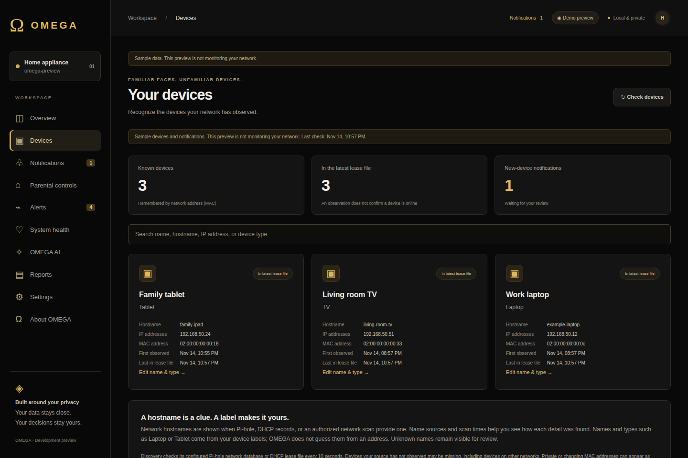
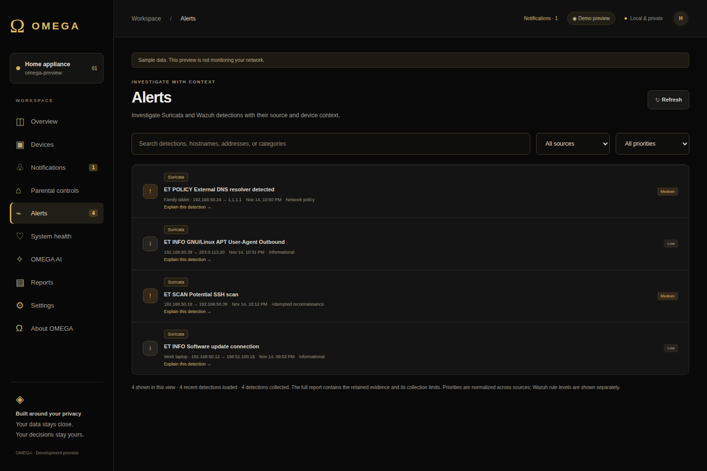

# See OMEGA with fictional data

These screenshots and the short recording show the experimental source preview,
using only the project's fictional demo data. No live network was inspected.

[Watch or download the 47-second demo (MP4, under 1 MB)](media/omega-demo.mp4?raw=true).
The silent recording includes captions for the overview, device inventory,
alerts, notifications, AI connection status and report interface.

## Security overview



## Devices



## Alert review



## Guided setup preview


## Run the demos locally

From the repository root on a Linux development workstation:

```sh
python3 -B dashboard/server.py --demo
```

Open `http://127.0.0.1:8088`. For the separate setup simulation:

```sh
python3 -B onboarding/server.py --demo --port 8092
```

Open `http://127.0.0.1:8092` and enter the published fictional pairing code
`OMEGA-PREVIEW`. Both demos use the Python standard library and local modules.
Keep their listeners on loopback. See the [source-preview guide](source-preview.md)
for runtime details and test commands.

## What the demonstration establishes

The interfaces render and respond to fictional examples. The recording does
not demonstrate live sensor collection, AI inference, working remote access,
host blocking, hardware acceptance, or protection of a real network. AI is
disabled in demo mode; full report exports need a configured live collector.
Unavailable sources are shown as unavailable.

See [media provenance](media/README.md) and the
[validation report](source-preview-validation.md) for the evidence boundaries.
[Share early-user feedback](early-user-feedback.md) or
[ask about setup and training](setup-and-training.md) through public GitHub Issues.
